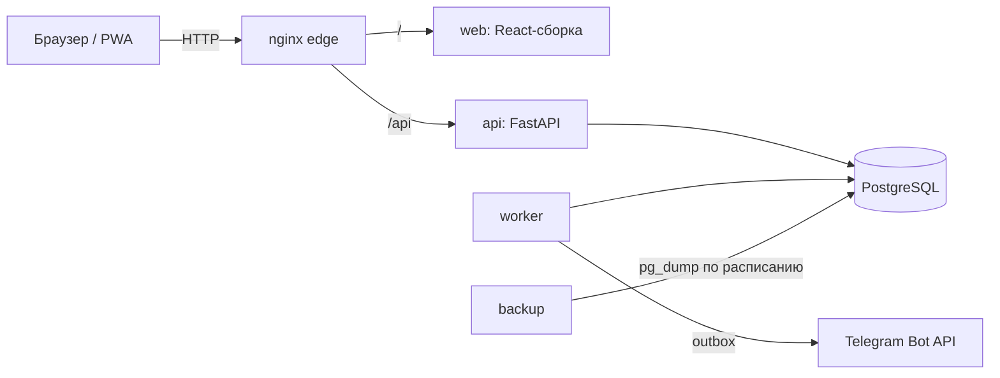

<div align="center">

# OSMI CRM

**CRM для сети автосервисов и детейлинга**

Записи на посты, заказ-наряды, рабочее место механика, склад, касса, зарплата, отчёты и уведомления в Telegram — в одном PWA, который работает и на компьютере менеджера, и на телефоне механика.


</div>

---

## Возможности

| Раздел | Что умеет |
|---|---|
| **Календарь записей** | Сетка по постам и отделам (сервис / детейлинг), проверка пересечений, рабочие часы и часовой пояс точки, статусы «подтверждена → клиент приехал → в работе» |
| **Заказ-наряды** | Создание из записи или с нуля, работы и запчасти, согласование с клиентом, статусы от «Новый» до «Закрыт», печатные формы PDF, история изменений |
| **Рабочее место механика** | Мобильный интерфейс: задачи на сегодня, таймер работ, заявки на запчасти, рекомендации клиенту |
| **Клиенты и автомобили** | Карточки, госномер и VIN, история обслуживания, быстрый поиск, архив |
| **Склад** | Каталог запчастей, приходы, списания, резервы под заказы, остатки по точкам |
| **Касса** | Приём оплат (наличные, карта, перевод), сдача, возвраты, расходы, идемпотентные платежи |
| **Зарплата** | Схемы оплаты (оклад, процент, нормо-часы), корректировки, расчёт за период |
| **Отчёты** | Выручка, загрузка постов, механики, средний чек, экспорт в CSV/XLSX |
| **Журнал действий** | Кто, что и когда изменил, с фильтрами — для руководителя |
| **Telegram** | Уведомления о событиях через надёжную очередь (outbox) с повторами |
| **Офлайн** | PWA: интерфейс открывается без сети, изменяющие действия офлайн блокируются |

## Роли

| Роль | Доступ |
|---|---|
| **Руководитель** | Все точки, отчёты, зарплата, журнал, пользователи, настройки, возвраты |
| **Менеджер** | Свои точки: записи, заказы, клиенты, склад, касса (без возвратов), каталог |
| **Механик** | Свои задачи, таймеры, заявки на запчасти, рекомендации |

## Архитектура



| Слой | Технологии |
|---|---|
| Бэкенд | Python, FastAPI, SQLAlchemy 2 (async), asyncpg, Alembic, Pydantic 2, argon2id, JWT |
| Фронтенд | React 18, TypeScript, Vite, TanStack Query, Tailwind CSS, lucide-react, vite-plugin-pwa |
| Инфраструктура | Docker Compose, nginx, PostgreSQL, фоновый воркер, ежедневные бэкапы с проверкой восстановления |
| Качество | pytest (покрытие ≥ 85 %, сейчас 91 %), ruff, mypy strict, Vitest + MSW, ESLint, контроль размера бандла, GitHub Actions |

## Быстрый старт (Docker)

```bash
git clone https://github.com/Edvvard0/osmi_crm.git
cd osmi_crm
docker compose up -d --build      # или: make up
make seed                         # первый руководитель
```

| Адрес | Что там |
|---|---|
| http://localhost:8080 | приложение |
| http://localhost:8080/api/v1/health | состояние системы |
| http://localhost:8080/api/docs | Swagger (только в dev) |

Запуск без Docker (локальный PostgreSQL, uvicorn, Vite) описан в [docs/architecture.md](docs/architecture.md#локальная-разработка).

## Команды

| Команда | Что делает |
|---|---|
| `make up` / `make down` / `make logs` | запуск, остановка, логи |
| `make migrate` | миграции Alembic |
| `make seed` | создать первого руководителя |
| `make test` | тесты, линтеры, mypy и покрытие в одноразовых контейнерах |
| `make lint` | ruff + mypy |
| `make prod-up` | продакшен: БД, миграции, API, воркер, фронтенд, nginx, бэкапы |
| `make prod-seed` | первый руководитель на проде |
| `make prod-demo` | демо-данные для показа (пароли передаются через окружение) |
| `make prod-backup` / `make prod-restore-check` | бэкап и проверка восстановления |

На Windows без `make` выполняйте команды из `Makefile` напрямую.

## Развёртывание

```bash
cp .env.prod.example .env.prod    # заполнить секреты
make prod-up
make prod-seed
```

- **С доменом** — nginx с TLS (Let's Encrypt), HSTS, порты 80/443.
- **Без домена** — задайте в `.env.prod` `DOMAIN=<IP>` и `HTTP_PORT=8088`: приложение откроется на `http://<IP>:8088`, порты 80/443 не занимаются и не мешают другим проектам на сервере.

Подробности (TLS, обновление, бэкапы, мониторинг, Telegram-вебхук) — в [docs/deployment.md](docs/deployment.md).

### Демо-данные

```bash
DEMO_MANAGER_PASSWORD='…' DEMO_MECHANIC_PASSWORD='…' make prod-demo
```

Создаёт две точки, посты, каталог услуг и запчастей, 15 клиентов, заказ-наряды во всех статусах, оплаты, расходы, схемы зарплаты, а также сотрудников `manager1–2` и `mechanic1–4`. Повторный запуск ничего не дублирует. Пароли в файлах не хранятся.

## Безопасность

- **Инъекции.** SQL — только через ORM и параметры. Все входные схемы Pydantic с `extra="forbid"` и строгими типами (`SafeText`, `Phone`, `PlateNumber`, `VIN`, `Login`, `Money`). Разметка (`<`, `>`) отклоняется с понятной ошибкой у поля.
- **XSS.** React экранирует вывод, строгая CSP без `unsafe-inline` для скриптов, сборка без source maps.
- **Аутентификация.** argon2id, блокировка после неудачных входов, rate limit; access-токен хранится только в памяти, refresh — httpOnly-cookie с ротацией и отзывом сессий.
- **Ошибки.** Единый формат; 500 без деталей; 422 без введённых значений; фронтенд показывает тексты из своего словаря, а не ответ сервера.
- **Прод.** Swagger и OpenAPI отключены, заголовки безопасности, отдельный пользователь БД с минимальными правами.

## Структура

```
backend/
  app/api/v1/      HTTP-эндпоинты (подключаются автоматически)
  app/services/    бизнес-логика
  app/models/      модели SQLAlchemy
  app/schemas/     схемы Pydantic
  app/worker.py    фоновые задачи и outbox Telegram
  migrations/      Alembic
  tests/           pytest
frontend/
  src/pages/       экраны
  src/features/    модули: записи, заказы, касса, склад, отчёты…
  src/shared/      API-клиент, UI-компоненты, утилиты
  src/test/        Vitest + MSW
deploy/            nginx, бэкапы, скрипты эксплуатации
docs/              документация
```

## Документация

| Документ | О чём |
|---|---|
| [Руководство пользователя](docs/user-guide.md) | работа в системе для каждой роли |
| [Архитектура](docs/architecture.md) | устройство, локальная разработка, тесты |
| [Развёртывание](docs/deployment.md) | прод, бэкапы, обновление, мониторинг |
| [Схема БД](docs/02-database-schema.md) · [Экраны](docs/03-ui-screens.md) · [План](docs/01-development-plan.md) | проектные документы |
| `docs/api-contract-m*.md` | контракты API по модулям |
