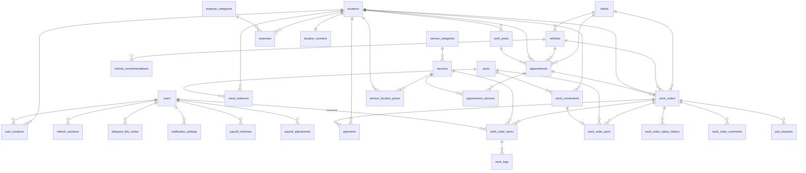

# Схема базы данных

> Версия 1.1 · 09.11.2026 · PostgreSQL 16
> Связанные документы: [01-development-plan.md](01-development-plan.md), [03-ui-screens.md](03-ui-screens.md)

---

## 1. Соглашения

| Правило | Описание |
|---|---|
| Первичные ключи | `uuid`, генерируются приложением (UUIDv7 — упорядочены по времени, хорошо индексируются). Исключение — `audit_log` и `notification_outbox`: `bigint identity` |
| Имена | `snake_case`, таблицы во множественном числе, внешние ключи `<сущность>_id` |
| Время | Всегда `timestamptz` (хранится в UTC). Отображение — в часовом поясе точки |
| Деньги | `numeric(12,2)`, в Python — `Decimal`. `float` для денег запрещён |
| Количества | `numeric(12,3)` (литры, граммы, метры плёнки) |
| Перечисления | `varchar` + `CHECK (col IN (...))`, в Python — `StrEnum`. Новое значение добавляется миграцией без пересоздания типа |
| Служебные поля | `created_at`, `updated_at` (`DEFAULT now()`, `updated_at` обновляет SQLAlchemy `onupdate`) |
| Удаление | Справочники и клиенты не удаляются физически: `is_active` или `archived_at`. Финансовые данные и движения склада не удаляются никогда, исправление — обратной записью |
| Внешние ключи | `ON DELETE RESTRICT` по умолчанию. `CASCADE` только для дочерних записей без самостоятельного смысла (например, `user_locations`) |
| Снимки данных | В позициях заказа сохраняется копия названия и цены услуги или запчасти: изменение каталога не меняет старые заказы |
| Оптимистическая блокировка | Поле `version int` у `work_orders` (SQLAlchemy `version_id_col`) |

**Расширения:** `citext` (регистронезависимый логин), `pg_trgm` (поиск по подстроке), `btree_gist` (запрет пересечения записей).

**Роли БД:** `crm_migrator` (владелец схемы, DDL), `crm_app` (только DML, без `UPDATE`/`DELETE` на `audit_log` и `stock_movements`).

---

## 2. ER-диаграмма



---

## 3. Таблицы

Обозначения: **PK** — первичный ключ, **FK** — внешний ключ, **U** — уникальный, **NN** — `NOT NULL`.

### 3.1 Точки, пользователи, доступ

#### `locations` — точки (филиалы)
| Поле | Тип | Ограничения | Описание |
|---|---|---|---|
| id | uuid | PK | |
| name | varchar(100) | NN, U | Название точки |
| code | varchar(10) | NN, U, `CHECK (code ~ '^[A-Z0-9]{2,10}$')` | Префикс номера заказ-наряда, например `MSK1` |
| address | varchar(255) | NN | |
| phone | varchar(20) | | E.164 |
| timezone | varchar(64) | NN, default `'Europe/Moscow'` | IANA-зона |
| work_start | time | NN | Начало рабочего дня |
| work_end | time | NN, `CHECK (work_end > work_start)` | Конец рабочего дня |
| telegram_chat_id | bigint | | Групповой чат точки (необязательно) |
| is_active | boolean | NN, default `true` | |
| created_at, updated_at | timestamptz | NN | |

#### `users` — сотрудники
| Поле | Тип | Ограничения | Описание |
|---|---|---|---|
| id | uuid | PK | |
| login | citext | NN, U, `CHECK (login ~ '^[a-z0-9._-]{3,50}$')` | |
| password_hash | varchar(255) | NN | Argon2id |
| full_name | varchar(150) | NN | |
| phone | varchar(20) | | |
| role | varchar(20) | NN, `CHECK IN ('mechanic','manager','director')` | |
| is_active | boolean | NN, default `true` | |
| failed_login_count | smallint | NN, default 0 | |
| locked_until | timestamptz | | |
| last_login_at | timestamptz | | |
| password_changed_at | timestamptz | | Пароль меняет сам сотрудник в «Настройках» или руководитель; принудительной смены при входе нет |
| telegram_chat_id | bigint | U | Привязанный чат |
| telegram_username | varchar(64) | | Для отображения |
| created_by | uuid | FK → users | |
| created_at, updated_at | timestamptz | NN | |

#### `user_locations` — доступ сотрудника к точкам
| Поле | Тип | Ограничения |
|---|---|---|
| user_id | uuid | PK, FK → users `ON DELETE CASCADE` |
| location_id | uuid | PK, FK → locations `ON DELETE CASCADE` |
| created_at | timestamptz | NN |

Руководитель видит все точки независимо от этой таблицы.

#### `refresh_sessions` — сессии (refresh-токены)
| Поле | Тип | Ограничения | Описание |
|---|---|---|---|
| id | uuid | PK | |
| user_id | uuid | NN, FK → users | |
| token_hash | char(64) | NN, U | SHA-256 токена; сам токен не хранится |
| family_id | uuid | NN | Цепочка ротации; повторное использование отзывает всю цепочку |
| user_agent | varchar(255) | | |
| ip | inet | | |
| created_at | timestamptz | NN | |
| expires_at | timestamptz | NN | |
| revoked_at | timestamptz | | |

Индексы: `(user_id) WHERE revoked_at IS NULL`, `(family_id)`, `(expires_at)` для очистки.

#### `telegram_link_codes` — одноразовые коды привязки Telegram
| Поле | Тип | Ограничения |
|---|---|---|
| id | uuid | PK |
| user_id | uuid | NN, FK → users |
| code_hash | char(64) | NN, U |
| expires_at | timestamptz | NN (создание + 10 минут) |
| used_at | timestamptz | |
| created_at | timestamptz | NN |

---

### 3.2 Клиенты и автомобили

#### `clients`
| Поле | Тип | Ограничения | Описание |
|---|---|---|---|
| id | uuid | PK | |
| client_type | varchar(10) | NN, `CHECK IN ('person','company')` | |
| full_name | varchar(150) | NN | ФИО или контактное лицо |
| company_name | varchar(200) | | |
| inn | varchar(12) | `CHECK (inn ~ '^\d{10}(\d{2})?$')` | |
| phone | varchar(20) | NN, U | E.164, основной |
| phone_extra | varchar(20) | | |
| email | varchar(254) | | Только как контакт, рассылок нет |
| source | varchar(20) | `CHECK IN ('walk_in','referral','online','ads','repeat','other')` | |
| discount_percent | numeric(5,2) | NN, default 0, `CHECK (0..100)` | Персональная скидка |
| notes | varchar(2000) | | Очищено от HTML |
| telegram_chat_id | bigint | | Резерв под уведомления клиентам |
| created_by | uuid | FK → users | |
| created_at, updated_at | timestamptz | NN | |
| archived_at | timestamptz | | |

Индексы: GIN `gin_trgm_ops` по `full_name`, `phone`, `company_name`.

#### `vehicles`
| Поле | Тип | Ограничения | Описание |
|---|---|---|---|
| id | uuid | PK | |
| client_id | uuid | NN, FK → clients | Текущий владелец |
| make | varchar(50) | NN | Марка |
| model | varchar(50) | NN | Модель |
| year | smallint | `CHECK (year BETWEEN 1950 AND 2100)` | |
| vin | varchar(17) | `CHECK (vin ~ '^[A-HJ-NPR-Z0-9]{17}$')` | |
| plate_number | varchar(12) | | Нормализован: верхний регистр, латиница |
| color | varchar(30) | | |
| mileage | integer | `CHECK (mileage >= 0)` | Последний известный пробег |
| notes | varchar(1000) | | |
| created_at, updated_at | timestamptz | NN | |
| archived_at | timestamptz | | |

Индексы: уникальный `(vin) WHERE vin IS NOT NULL AND archived_at IS NULL`, `(plate_number)`, GIN trgm по `plate_number`, `vin`, `(client_id)`.

#### `vehicle_recommendations` — рекомендации к следующему визиту
| Поле | Тип | Ограничения |
|---|---|---|
| id | uuid | PK |
| vehicle_id | uuid | NN, FK → vehicles |
| work_order_id | uuid | FK → work_orders |
| text | varchar(1000) | NN |
| priority | varchar(10) | NN, `CHECK IN ('low','medium','high')` |
| status | varchar(10) | NN, `CHECK IN ('open','done','declined')` |
| created_by | uuid | NN, FK → users |
| created_at, updated_at | timestamptz | NN |

---

### 3.3 Каталог и посты

#### `service_categories`
| Поле | Тип | Ограничения |
|---|---|---|
| id | uuid | PK |
| name | varchar(100) | NN |
| department | varchar(10) | NN, `CHECK IN ('service','detailing')` |
| sort_order | smallint | NN, default 0 |
| is_active | boolean | NN, default `true` |

U: `(department, name)`.

#### `services` — услуги
| Поле | Тип | Ограничения | Описание |
|---|---|---|---|
| id | uuid | PK | |
| category_id | uuid | NN, FK → service_categories | |
| code | varchar(20) | NN, U | Артикул услуги |
| name | varchar(200) | NN | |
| description | varchar(1000) | | |
| department | varchar(10) | NN | Копия из категории для быстрых фильтров |
| unit | varchar(10) | NN, `CHECK IN ('pcs','hour','set','sqm')` | |
| base_price | numeric(12,2) | NN, `CHECK (>= 0)` | |
| norm_hours | numeric(5,2) | NN, default 0 | Норматив времени |
| duration_minutes | integer | NN, `CHECK (> 0)` | Для планирования в календаре |
| is_active | boolean | NN, default `true` | |
| created_at, updated_at | timestamptz | NN | |

#### `service_location_prices` — цена услуги в точке
| Поле | Тип | Ограничения |
|---|---|---|
| service_id | uuid | PK, FK → services |
| location_id | uuid | PK, FK → locations |
| price | numeric(12,2) | NN, `CHECK (>= 0)` |
| updated_at | timestamptz | NN |

Цена в точке = `service_location_prices.price`, если есть, иначе `services.base_price`.

#### `work_posts` — посты и боксы
| Поле | Тип | Ограничения |
|---|---|---|
| id | uuid | PK |
| location_id | uuid | NN, FK → locations |
| name | varchar(50) | NN |
| post_type | varchar(20) | NN, `CHECK IN ('lift','diagnostics','detailing_box','wash','other')` |
| department | varchar(10) | NN, `CHECK IN ('service','detailing')` |
| sort_order | smallint | NN, default 0 |
| is_active | boolean | NN, default `true` |

U: `(location_id, name)`.

#### `parts` — справочник запчастей и материалов
| Поле | Тип | Ограничения | Описание |
|---|---|---|---|
| id | uuid | PK | |
| sku | varchar(50) | NN, U | Артикул |
| name | varchar(200) | NN | |
| brand | varchar(100) | | |
| barcode | varchar(50) | U | |
| unit | varchar(10) | NN, `CHECK IN ('pcs','l','ml','kg','g','m','set')` | |
| department | varchar(10) | NN, `CHECK IN ('service','detailing','both')` | |
| sale_price | numeric(12,2) | NN, `CHECK (>= 0)` | Цена продажи по умолчанию |
| is_active | boolean | NN, default `true` | |
| created_at, updated_at | timestamptz | NN | |

Индекс: GIN trgm по `name`, `sku`.

---

### 3.4 Запись

#### `appointments`
| Поле | Тип | Ограничения | Описание |
|---|---|---|---|
| id | uuid | PK | |
| location_id | uuid | NN, FK → locations | |
| client_id | uuid | NN, FK → clients | |
| vehicle_id | uuid | NN, FK → vehicles | |
| post_id | uuid | FK → work_posts | Может быть не назначен |
| department | varchar(10) | NN | |
| start_at | timestamptz | NN | |
| end_at | timestamptz | NN, `CHECK (end_at > start_at)` | |
| status | varchar(15) | NN, `CHECK IN ('scheduled','confirmed','arrived','no_show','cancelled')` | |
| comment | varchar(1000) | | |
| work_order_id | uuid | U, FK → work_orders | Заказ, созданный из записи |
| created_by | uuid | NN, FK → users | |
| created_at, updated_at | timestamptz | NN | |

**Запрет пересечений на посту:**
```sql
ALTER TABLE appointments ADD CONSTRAINT appointments_no_overlap
  EXCLUDE USING gist (
    post_id WITH =,
    tstzrange(start_at, end_at, '[)') WITH &&
  ) WHERE (status IN ('scheduled','confirmed','arrived') AND post_id IS NOT NULL);
```
Интервал полуоткрытый `[)`: запись 10:00–11:00 и 11:00–12:00 не конфликтуют.

Индексы: `(location_id, start_at)`, `(client_id)`.

#### `appointment_services` — предварительный список услуг записи
| Поле | Тип | Ограничения |
|---|---|---|
| appointment_id | uuid | PK, FK → appointments `ON DELETE CASCADE` |
| service_id | uuid | PK, FK → services |

---

### 3.5 Заказ-наряды

#### `location_counters` — счётчики номеров
| Поле | Тип | Ограничения |
|---|---|---|
| location_id | uuid | PK, FK → locations |
| counter_type | varchar(20) | PK, `CHECK IN ('work_order')` |
| last_value | bigint | NN, default 0 |

Номер выдаётся атомарно в транзакции создания заказа:
```sql
UPDATE location_counters SET last_value = last_value + 1
WHERE location_id = :loc AND counter_type = 'work_order'
RETURNING last_value;
```
Блокировка строки гарантирует отсутствие дублей и пропусков при откате транзакции.

#### `work_orders`
| Поле | Тип | Ограничения | Описание |
|---|---|---|---|
| id | uuid | PK | |
| number | varchar(20) | NN, U | `MSK1-000123` |
| location_id | uuid | NN, FK → locations | |
| client_id | uuid | NN, FK → clients | |
| vehicle_id | uuid | NN, FK → vehicles | |
| department | varchar(10) | NN, `CHECK IN ('service','detailing','mixed')` | |
| status | varchar(20) | NN, см. ниже | |
| manager_id | uuid | NN, FK → users | Ответственный менеджер |
| mileage_in | integer | `CHECK (>= 0)` | Пробег при приёмке |
| complaint | varchar(2000) | | Со слов клиента |
| intake_notes | varchar(2000) | | Состояние авто при приёме: повреждения, комплектность, уровень топлива (фото не используются) |
| diagnosis | varchar(4000) | | |
| planned_ready_at | timestamptz | | |
| started_at | timestamptz | | |
| ready_at | timestamptz | | |
| closed_at | timestamptz | | |
| cancel_reason | varchar(500) | `CHECK (status <> 'cancelled' OR cancel_reason IS NOT NULL)` | |
| discount_percent | numeric(5,2) | NN, default 0, `CHECK (0..100)` | Скидка на заказ |
| works_total | numeric(12,2) | NN, default 0 | Пересчитывается сервером |
| parts_total | numeric(12,2) | NN, default 0 | |
| discount_total | numeric(12,2) | NN, default 0 | |
| total | numeric(12,2) | NN, default 0 | |
| paid_total | numeric(12,2) | NN, default 0 | |
| payment_status | varchar(10) | NN, `CHECK IN ('unpaid','partial','paid','refunded')` | |
| version | integer | NN, default 1 | Оптимистическая блокировка |
| created_at, updated_at | timestamptz | NN | |

Статусы: `new`, `diagnostics`, `awaiting_approval`, `in_progress`, `awaiting_parts`, `quality_check`, `ready`, `closed`, `cancelled`.

Индексы: `(location_id, status)`, `(location_id, created_at DESC)`, `(client_id)`, `(vehicle_id)`, `(manager_id)`, частичный `(planned_ready_at) WHERE status NOT IN ('closed','cancelled')` для поиска просрочек.

#### `work_order_items` — работы в заказе
| Поле | Тип | Ограничения | Описание |
|---|---|---|---|
| id | uuid | PK | |
| work_order_id | uuid | NN, FK → work_orders | |
| service_id | uuid | FK → services | NULL для произвольной работы |
| name | varchar(200) | NN | Снимок названия |
| department | varchar(10) | NN | |
| quantity | numeric(8,2) | NN, `CHECK (> 0)` | |
| unit_price | numeric(12,2) | NN, `CHECK (>= 0)` | Снимок цены |
| discount_percent | numeric(5,2) | NN, default 0 | |
| total | numeric(12,2) | NN | Считает сервер |
| norm_hours | numeric(5,2) | NN, default 0 | |
| mechanic_id | uuid | FK → users | Исполнитель |
| status | varchar(15) | NN, `CHECK IN ('pending','in_progress','paused','done','cancelled')` | |
| started_at | timestamptz | | Первый старт |
| finished_at | timestamptz | | |
| actual_minutes | integer | NN, default 0 | Сумма по `work_logs` |
| sort_order | smallint | NN, default 0 | |
| created_at, updated_at | timestamptz | NN | |

Индексы: `(work_order_id)`, `(mechanic_id, status)`, `(mechanic_id, finished_at)` для зарплаты.

#### `work_logs` — интервалы работы механика (таймер)
| Поле | Тип | Ограничения |
|---|---|---|
| id | uuid | PK |
| item_id | uuid | NN, FK → work_order_items |
| mechanic_id | uuid | NN, FK → users |
| started_at | timestamptz | NN |
| ended_at | timestamptz | `CHECK (ended_at IS NULL OR ended_at > started_at)` |

**Одна активная работа на механика:**
```sql
CREATE UNIQUE INDEX work_logs_one_active_per_mechanic
  ON work_logs (mechanic_id) WHERE ended_at IS NULL;
```

Индекс `(mechanic_id, started_at)` — для зарплаты и тепловой карты активности.

**Тепловая карта активности.** Отдельная таблица не нужна: часы по дням считаются запросом к `work_logs` в часовом поясе точки. Интервал, проходящий через полночь, делится между днями, незавершённый интервал считается до текущего момента:
```sql
SELECT d::date AS day,
       sum(extract(epoch FROM
             least(coalesce(wl.ended_at, now()), (d + interval '1 day') AT TIME ZONE :tz)
           - greatest(wl.started_at, d AT TIME ZONE :tz))) / 3600 AS hours,
       count(DISTINCT wl.item_id) AS items
FROM generate_series(:from::timestamp, :to::timestamp, interval '1 day') AS d
JOIN work_logs wl
  ON wl.mechanic_id = :user_id
 AND wl.started_at < (d + interval '1 day') AT TIME ZONE :tz
 AND coalesce(wl.ended_at, now()) > d AT TIME ZONE :tz
GROUP BY d;
```
Для менеджера и руководителя активность считается по `audit_log` (индекс `(user_id, created_at DESC)` уже есть). Если на объёмах из плана запрос окажется медленнее 200 мс, добавляется материализованное представление `employee_daily_activity` с ночным обновлением.

#### `work_order_parts` — запчасти и материалы в заказе
| Поле | Тип | Ограничения | Описание |
|---|---|---|---|
| id | uuid | PK | |
| work_order_id | uuid | NN, FK → work_orders | |
| part_id | uuid | FK → parts | NULL — запчасть клиента или разовая |
| name | varchar(200) | NN | Снимок |
| quantity | numeric(12,3) | NN, `CHECK (> 0)` | |
| unit_price | numeric(12,2) | NN | Цена продажи |
| unit_cost | numeric(12,2) | | Себестоимость на момент списания |
| total | numeric(12,2) | NN | |
| stock_movement_id | uuid | U, FK → stock_movements | Движение списания со склада |
| added_by | uuid | NN, FK → users | |
| created_at | timestamptz | NN | |

#### `part_requests` — заявки механиков на запчасти
| Поле | Тип | Ограничения |
|---|---|---|
| id | uuid | PK |
| work_order_id | uuid | NN, FK → work_orders |
| item_id | uuid | FK → work_order_items |
| mechanic_id | uuid | NN, FK → users |
| part_id | uuid | FK → parts |
| description | varchar(500) | NN |
| quantity | numeric(12,3) | NN, `CHECK (> 0)` |
| status | varchar(10) | NN, `CHECK IN ('new','approved','rejected','issued')` |
| handled_by | uuid | FK → users |
| handled_at | timestamptz | |
| reject_reason | varchar(500) | |
| created_at | timestamptz | NN |

Индекс: `(status, created_at)`.

#### `work_order_status_history`
| Поле | Тип | Ограничения |
|---|---|---|
| id | uuid | PK |
| work_order_id | uuid | NN, FK → work_orders |
| from_status | varchar(20) | |
| to_status | varchar(20) | NN |
| changed_by | uuid | NN, FK → users |
| comment | varchar(500) | |
| created_at | timestamptz | NN |

#### `work_order_comments`
| Поле | Тип | Ограничения |
|---|---|---|
| id | uuid | PK |
| work_order_id | uuid | NN, FK → work_orders |
| item_id | uuid | FK → work_order_items |
| author_id | uuid | NN, FK → users |
| text | varchar(2000) | NN |
| is_internal | boolean | NN, default `true` |
| created_at | timestamptz | NN |

---

### 3.6 Склад

#### `stock_balances` — остатки
| Поле | Тип | Ограничения |
|---|---|---|
| location_id | uuid | PK, FK → locations |
| part_id | uuid | PK, FK → parts |
| quantity | numeric(12,3) | NN, default 0, `CHECK (quantity >= 0)` |
| avg_cost | numeric(12,2) | NN, default 0 |
| min_quantity | numeric(12,3) | NN, default 0 |
| updated_at | timestamptz | NN |

Изменяется только сервисом склада в той же транзакции, что и движение, с `SELECT ... FOR UPDATE`.

#### `stock_movements` — движения (неизменяемые)
| Поле | Тип | Ограничения | Описание |
|---|---|---|---|
| id | uuid | PK | |
| location_id | uuid | NN, FK → locations | |
| part_id | uuid | NN, FK → parts | |
| movement_type | varchar(20) | NN, `CHECK IN ('receipt','issue_to_order','return_from_order','write_off','transfer_out','transfer_in','adjustment')` | |
| quantity | numeric(12,3) | NN, `CHECK (quantity <> 0)` | Со знаком: + приход, − расход |
| unit_cost | numeric(12,2) | NN | |
| work_order_id | uuid | FK → work_orders | |
| related_movement_id | uuid | FK → stock_movements | Парное движение перемещения или сторно |
| supplier | varchar(200) | | Для прихода |
| document_number | varchar(50) | | Номер накладной |
| reason | varchar(500) | | Обязательна для списания и корректировки (проверка в сервисе) |
| created_by | uuid | NN, FK → users | |
| created_at | timestamptz | NN | |

Индексы: `(location_id, part_id, created_at DESC)`, `(work_order_id)`.

---

### 3.7 Касса и расходы

#### `payments`
| Поле | Тип | Ограничения | Описание |
|---|---|---|---|
| id | uuid | PK | |
| work_order_id | uuid | NN, FK → work_orders | |
| location_id | uuid | NN, FK → locations | Для кассовых отчётов |
| payment_type | varchar(10) | NN, `CHECK IN ('payment','refund')` | |
| amount | numeric(12,2) | NN, `CHECK (amount > 0)` | Всегда положительная, знак задаёт тип |
| method | varchar(10) | NN, `CHECK IN ('cash','card','transfer','other')` | |
| paid_at | timestamptz | NN | |
| refund_of_id | uuid | FK → payments | |
| comment | varchar(500) | `CHECK (payment_type = 'payment' OR comment IS NOT NULL)` | Причина возврата обязательна |
| accepted_by | uuid | NN, FK → users | |
| created_at | timestamptz | NN | |

Индексы: `(location_id, paid_at)`, `(work_order_id)`.

#### `expense_categories`
| Поле | Тип | Ограничения |
|---|---|---|
| id | uuid | PK |
| name | varchar(100) | NN, U |
| is_active | boolean | NN, default `true` |

#### `expenses`
| Поле | Тип | Ограничения |
|---|---|---|
| id | uuid | PK |
| location_id | uuid | NN, FK → locations |
| category_id | uuid | NN, FK → expense_categories |
| amount | numeric(12,2) | NN, `CHECK (amount > 0)` |
| method | varchar(10) | NN, `CHECK IN ('cash','card','transfer','other')` |
| expense_date | date | NN |
| description | varchar(500) | |
| created_by | uuid | NN, FK → users |
| created_at | timestamptz | NN |
| cancelled_at | timestamptz | |
| cancelled_by | uuid | FK → users |

Индекс: `(location_id, expense_date)`.

---

### 3.8 Зарплата

#### `payroll_schemes` — схема оплаты сотрудника
| Поле | Тип | Ограничения | Описание |
|---|---|---|---|
| id | uuid | PK | |
| user_id | uuid | NN, FK → users | |
| scheme_type | varchar(20) | NN, `CHECK IN ('percent_of_works','per_norm_hour','fixed_plus_percent','fixed')` | |
| percent | numeric(5,2) | `CHECK (0..100)` | Процент от суммы работ |
| norm_hour_rate | numeric(12,2) | | Ставка за нормочас |
| fixed_monthly | numeric(12,2) | | Оклад |
| department | varchar(10) | `CHECK IN ('service','detailing')` | NULL — для всех работ; иначе отдельная схема на отдел |
| valid_from | date | NN | |
| valid_to | date | | NULL — действует сейчас |
| created_by | uuid | NN, FK → users | |
| created_at | timestamptz | NN | |

Пересечение периодов действия для одного сотрудника и отдела запрещено exclusion-ограничением по `daterange(valid_from, valid_to)`.

#### `payroll_adjustments` — премии и удержания
| Поле | Тип | Ограничения |
|---|---|---|
| id | uuid | PK |
| user_id | uuid | NN, FK → users |
| period_month | date | NN, `CHECK (extract(day FROM period_month) = 1)` |
| amount | numeric(12,2) | NN, `CHECK (amount <> 0)` |
| reason | varchar(500) | NN |
| created_by | uuid | NN, FK → users |
| created_at | timestamptz | NN |

Расчёт зарплаты не хранится, а вычисляется по выполненным работам (`work_order_items.status = 'done'` в закрытых заказах) и корректировкам за период.

---

### 3.9 Уведомления

#### `notification_settings`
| Поле | Тип | Ограничения |
|---|---|---|
| user_id | uuid | PK, FK → users `ON DELETE CASCADE` |
| event_type | varchar(50) | PK |
| is_enabled | boolean | NN, default `true` |

Если записи нет, действует значение по умолчанию для роли.

#### `notification_outbox` — очередь отправки
| Поле | Тип | Ограничения | Описание |
|---|---|---|---|
| id | bigint | PK, identity | |
| event_type | varchar(50) | NN | `work_item.assigned`, `stock.low` и т.д. |
| user_id | uuid | FK → users | Получатель-сотрудник |
| chat_id | bigint | NN | Куда отправлять |
| payload | jsonb | NN | Данные события |
| text | varchar(4096) | NN | Готовый текст, уже экранированный |
| status | varchar(10) | NN, `CHECK IN ('pending','sent','failed','skipped')` | |
| attempts | smallint | NN, default 0 | |
| next_attempt_at | timestamptz | NN, default `now()` | |
| last_error | varchar(500) | | |
| created_at | timestamptz | NN | |
| sent_at | timestamptz | | |

Индекс: `(next_attempt_at) WHERE status = 'pending'`. Воркер забирает пачку через `FOR UPDATE SKIP LOCKED`.

---

### 3.10 Настройки и аудит

#### `system_settings`
| Поле | Тип | Ограничения | Описание |
|---|---|---|---|
| key | varchar(50) | PK | `discount_alert_percent`, `daily_summary_time`, `heatmap_thresholds`, ... |
| value | jsonb | NN | Проверяется Pydantic-схемой по ключу |
| updated_by | uuid | FK → users | |
| updated_at | timestamptz | NN | |

#### `audit_log` — журнал действий (только добавление)
| Поле | Тип | Ограничения | Описание |
|---|---|---|---|
| id | bigint | PK, identity | |
| user_id | uuid | FK → users | NULL для системных действий и неудачного входа |
| action | varchar(30) | NN | `create`, `update`, `delete`, `status_change`, `login`, `login_failed`, `logout`, `password_change`, `refund` |
| entity_type | varchar(50) | NN | `work_order`, `service`, `user` и т.д. |
| entity_id | uuid | | |
| location_id | uuid | | |
| changes | jsonb | | `{"field": {"old": ..., "new": ...}}`, без паролей и токенов |
| ip | inet | | |
| user_agent | varchar(255) | | |
| created_at | timestamptz | NN, default `now()` | |

Индексы: `(created_at DESC)`, `(entity_type, entity_id)`, `(user_id, created_at DESC)`. При росте объёма — секционирование по месяцам.

```sql
REVOKE UPDATE, DELETE, TRUNCATE ON audit_log FROM crm_app;
REVOKE UPDATE, DELETE, TRUNCATE ON stock_movements FROM crm_app;
```

---

## 4. Ключевые бизнес-правила на уровне БД

| Правило | Как обеспечено |
|---|---|
| Пост не занят двумя записями одновременно | Exclusion constraint `appointments_no_overlap` |
| У механика одна активная работа | Уникальный частичный индекс `work_logs_one_active_per_mechanic` |
| Остаток не уходит в минус | `CHECK (quantity >= 0)` + `SELECT FOR UPDATE` |
| Номер заказа уникален и без пропусков | `location_counters` + `UPDATE ... RETURNING` в одной транзакции |
| Отмена заказа и возврат с причиной | `CHECK` на `cancel_reason` и `comment` |
| Неизменяемость движений и журнала | Отзыв прав `UPDATE`/`DELETE` у роли приложения |
| Не потерянные правки заказа | `version` (оптимистическая блокировка) |
| Нет дублей клиентов и VIN | Уникальные индексы `clients.phone`, `vehicles.vin` |

---

## 5. Порядок появления таблиц по модулям

| Модуль | Таблицы |
|---|---|
| 1 | `locations`, `users`, `user_locations`, `refresh_sessions`, `audit_log` |
| 2 | `clients`, `vehicles` |
| 3 | `service_categories`, `services`, `service_location_prices`, `work_posts`, `parts` |
| 4 | `appointments`, `appointment_services` |
| 5 | `location_counters`, `work_orders`, `work_order_items`, `work_order_parts`, `work_order_status_history`, `work_order_comments` |
| 6 | `work_logs`, `part_requests`, `vehicle_recommendations` |
| 7 | `telegram_link_codes`, `notification_settings`, `notification_outbox` |
| 8 | `stock_balances`, `stock_movements` |
| 9 | `payments`, `expense_categories`, `expenses` |
| 10 | `payroll_schemes`, `payroll_adjustments` |
| 11 | `system_settings` |

Внешние ключи на таблицы более поздних модулей добавляются миграцией того модуля, где появляется целевая таблица: например, `work_order_parts.stock_movement_id` — в модуле 8, `appointments.work_order_id` — в модуле 5.

Каждый модуль добавляет свои таблицы отдельной миграцией Alembic. Миграции проверяются в CI прогоном `upgrade → downgrade → upgrade` на пустой БД.
